# Banco Plata — Business & Product Analytics Portfolio

Case studies from my work as a **Business Product Analyst at Banco Plata** (digital bank, Mexico City), August –
November 2026.

I owned analytics for the **DSA (direct sales agents) acquisition channel**: field agents visit small businesses and
open **Plata Empresa** business accounts for them. My job was to show where the funnel loses clients and why, and to turn
that into changes in the process, the product and the team's daily routine — from Snowflake SQL and report pipelines
to an LLM-based quality review of every sales meeting, a redesigned visit flow in the agent app and a field guide.

> **Confidentiality.** Everything here is rewritten for a public portfolio. Agent and client names, contacts,
> recordings, transcripts, addresses and internal table names are removed or replaced (agents appear as
> "Agent 01", "Agent A"…). Screenshots come from anonymized copies of my reports; numbers are channel-level
> aggregates used to show the method and the size of the effects.

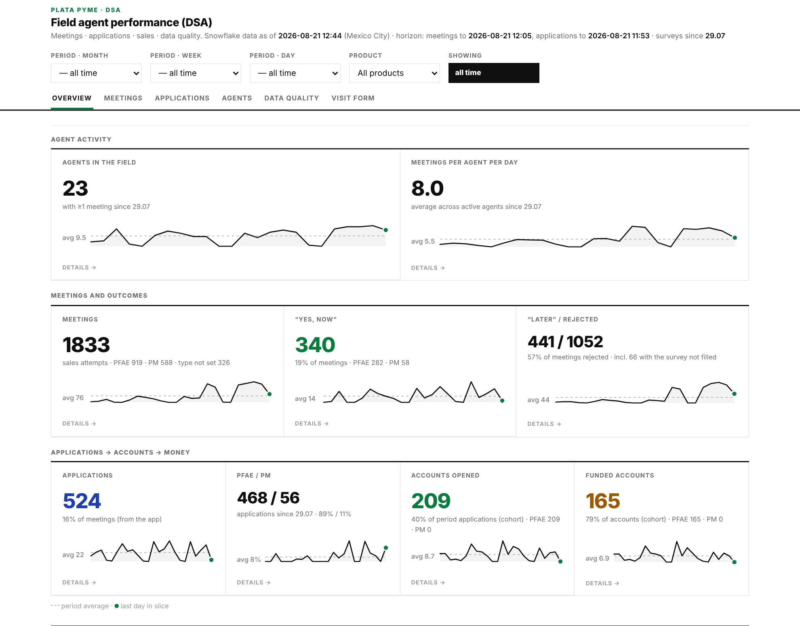

## Results at a glance

| Area | What I did | Outcome |
|---|---|---|
| Channel ownership | Ran reporting and analysis for the DSA acquisition channel end to end | Meeting → application conversion up **3%** |
| [Channel reporting](case-studies/01-dsa-channel-reporting.md) | Snowflake → Python pipeline → self-checking HTML report; Superset / Tableau dashboards | One source of truth for meetings, applications, accounts, plan and data quality; tagging bug and data gaps escalated |
| [AI quality assurance](case-studies/02-ai-qa-llm.md) | LLM review of recorded meetings on 31 criteria with quotes and timecodes; prompts and evals in Langfuse | Calibrated against human QA: **90–100% agreement on 16 of 29 criteria** |
| [Sales patterns study](case-studies/03-sales-patterns.md) | Best vs weak agents on 5,866 recorded meetings | Weak agents make 47% of visits but 8 of 109 accounts; explaining onboarding steps is the strongest sign of an account (**92% vs 67%**) |
| ["Other" rejections](case-studies/04-other-rejections.md) | Self-extending regex classifier for 740 free-text rejection reasons | **87%** were unfinished contacts, not rejections |
| [App visit flow & field guide](case-studies/05-agent-app-visit-flow-and-field-guide.md) | Screen-by-screen map of the agent app, redesign requirements, mobile field guide | "Owner absent" becomes a follow-up with a contact, never a rejection |
| [Weekly report & Slack alerts](case-studies/06-weekly-report-and-slack-alerts.md) | Friday coaching report on 9 criteria; daily Slack alerts for supervisors | Coaching tied to concrete recordings; suspicious visits flagged the same day |
| [Telesales partner program](case-studies/07-telesales-partner-program.md) | Funnel and LLM call-quality analysis of 23,751 calls; exact permutation tests | Questionnaire / consent errors identified as the signal of "empty" registrations |

## How the pieces fit together

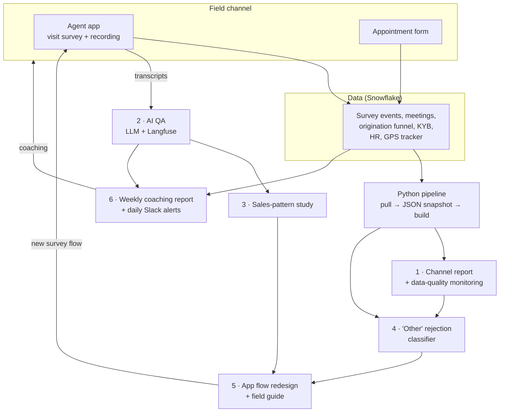

## Case studies

### 1. [DSA acquisition channel reporting](case-studies/01-dsa-channel-reporting.md)
Data model and attribution rules for a channel with no common keys, a self-checking report (six tabs, plan tracking,
cohorts, KYB ladder, 14-day forecast), and a data contract that surfaced a tagging bug and missing links.

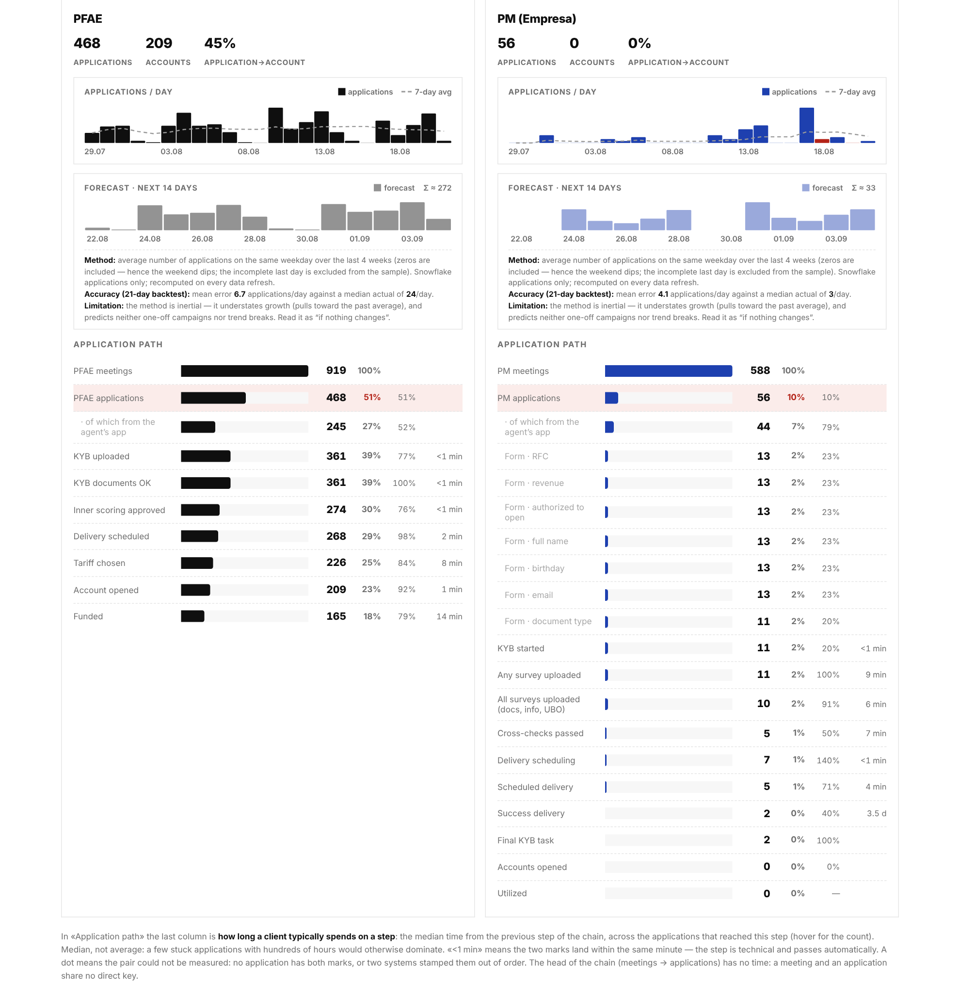 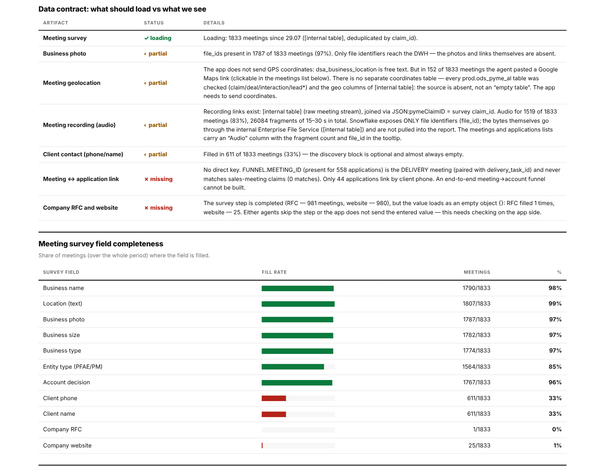

### 2. [AI QA: LLM review of every recorded sales meeting](case-studies/02-ai-qa-llm.md)
31 verifiable criteria (recording validity, compliance violations, sales steps), evidence-backed answers, a calibration
loop with human QA, prompt versions in Langfuse.

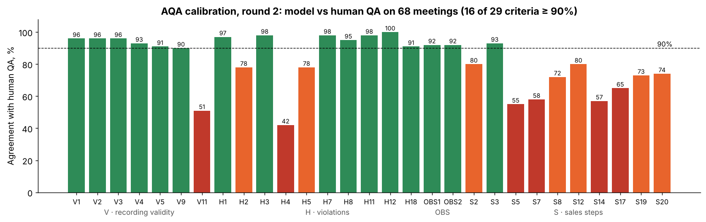

### 3. [How the best and the weakest agents sell](case-studies/03-sales-patterns.md)
The weak don't sell badly — they don't sell; the medium talk about the wrong benefits; the best sell simply and explain
the next steps. Recommendations and a two-week pilot design to prove causality.

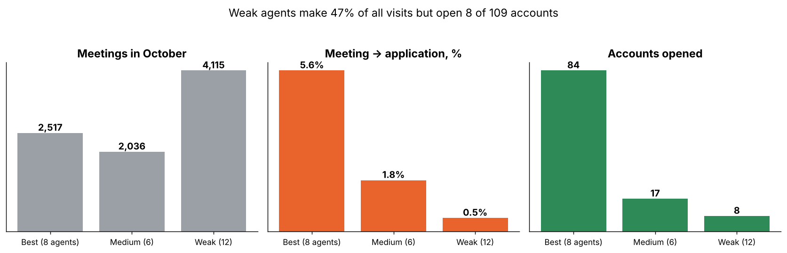

### 4. [Inside "Other": rejection free text](case-studies/04-other-rejections.md)
A regex dictionary that the business can extend in JSON, with automatic discovery of new patterns: 87% of "rejections"
were unfinished contacts.

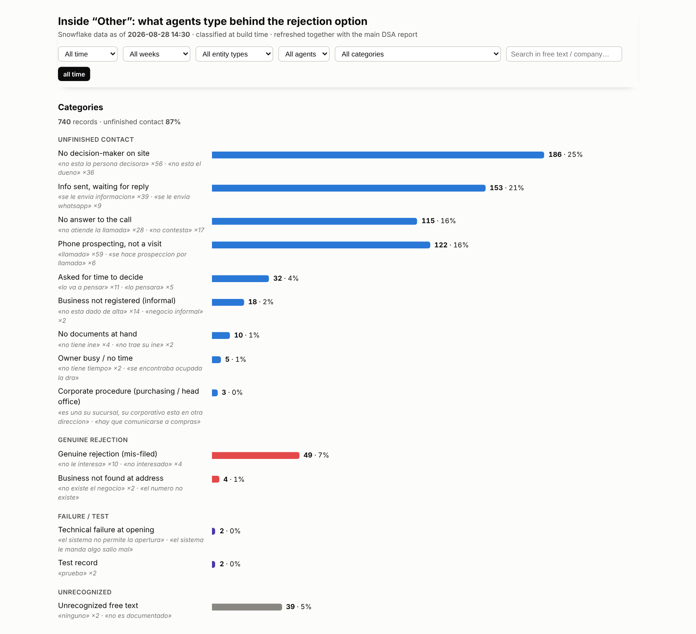

### 5. [Agent app: visit survey flow and field guide](case-studies/05-agent-app-visit-flow-and-field-guide.md)
The full visit flow mapped screen by screen from Figma, the "have you talked with the decision-maker?" redesign, and a
mobile guide for agents in Spanish.

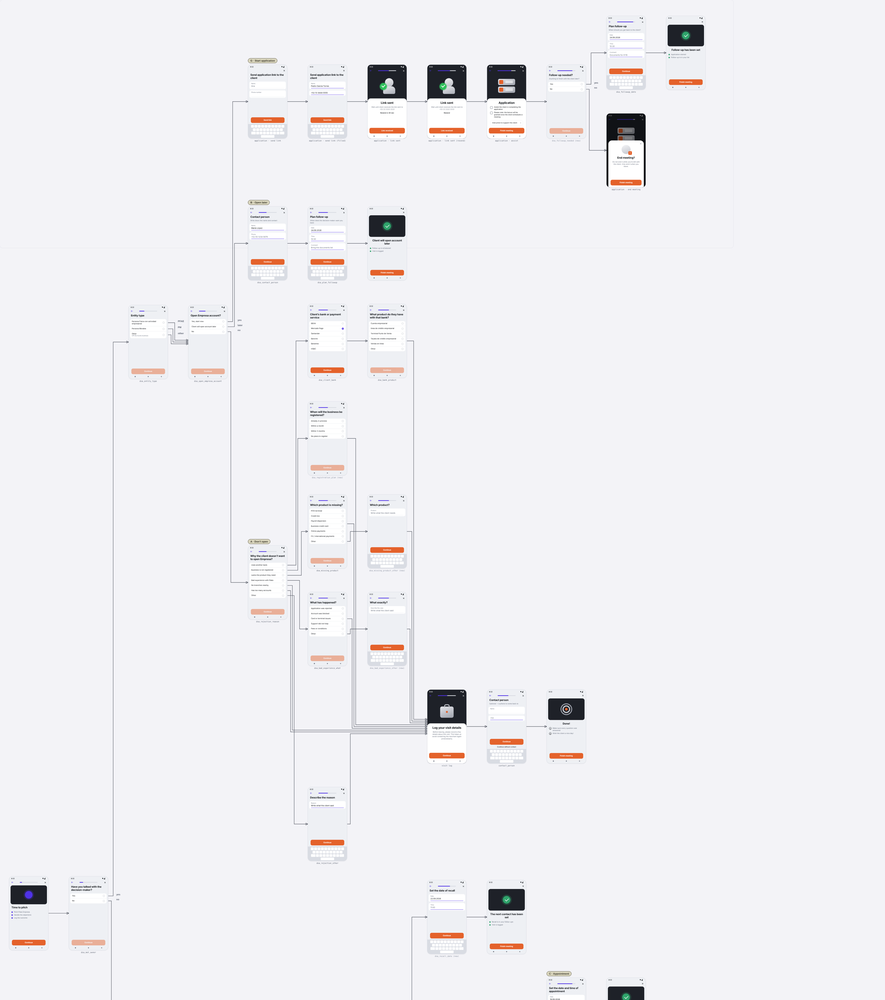 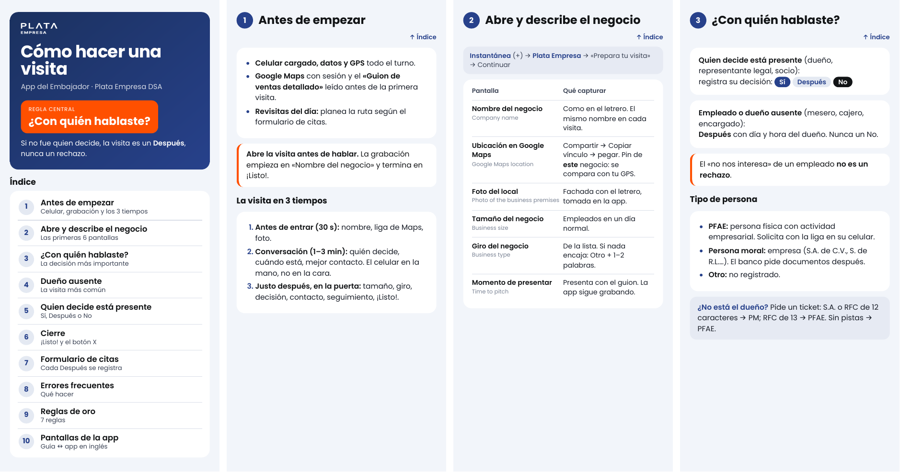

### 6. [Weekly coaching report and daily Slack alerts](case-studies/06-weekly-report-and-slack-alerts.md)
Nine coaching criteria with thresholds and prescribed actions, recordings to listen to, and Slack alerts that tell a
supervisor whom to call today.

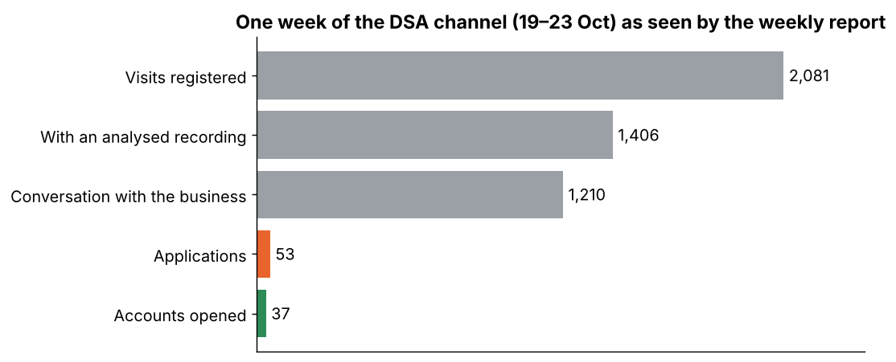

### 7. [Telesales partner program](case-studies/07-telesales-partner-program.md)
786 partners registered, 11.5% ever logged in, 0 invited accounts: errors in the questionnaire and consent — not the
overall error rate — predict empty registrations (exact permutation test over 7 agents).

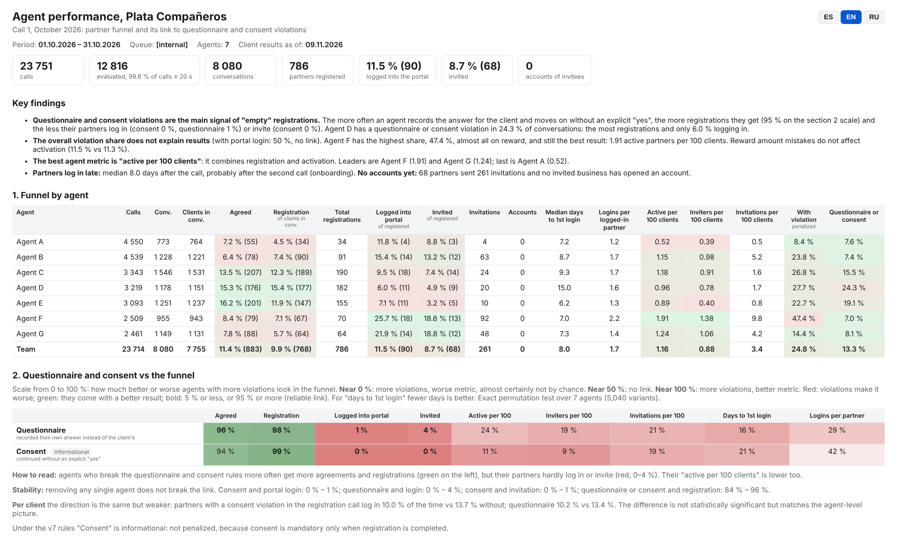

## Artifacts

- [`artifacts/visit_screen_flow.html`](artifacts/visit_screen_flow.html) — interactive screen-flow map of the agent's
  visit survey (download and open in a browser; zoom with Ctrl + mouse wheel; legend in Russian).
- [`artifacts/aqa_calibration.md`](artifacts/aqa_calibration.md) — model vs human QA agreement by criterion.
- [`assets/`](assets) — all screenshots and charts used in the case studies.

## Stack

- **Data:** Snowflake (SQL) · Python (pandas) · Superset · Tableau · static HTML/JS reports
- **AI:** LLM evaluation and prompt engineering · Langfuse · Claude Code
- **Product & delivery:** Figma · Miro · Jira · Confluence · GitLab · Slack bots
- **Operations:** Close and Crisp for client-case investigation · Google Forms

## How I work

1. **Start from the business question**, not the table: "why does a visit not turn into an application?"
2. **Fix the data model before the dashboard:** what is a meeting, an application, a sale; who gets credit; flow vs cohort.
3. **Check the data continuously:** data contracts, completeness, self-checks on every build, location sanity checks.
4. **Look at what actually happens** — read every recorded conversation at scale with an LLM, every claim backed by a
   quote and a timecode, calibrated against people.
5. **Separate correlation from cause:** groups built after tagging, permutation tests on small samples, a pilot design
   before rolling out a new script.
6. **Turn findings into one concrete change** — a survey screen, a coaching criterion, an alert, a sentence in the pitch —
   and automate the report so the team sees the same numbers every week.

---
Konstantin Rudnev · [LinkedIn](https://www.linkedin.com/in/konstantin-rudnev-a96727354) · [GitHub](https://github.com/Konstantin667)
