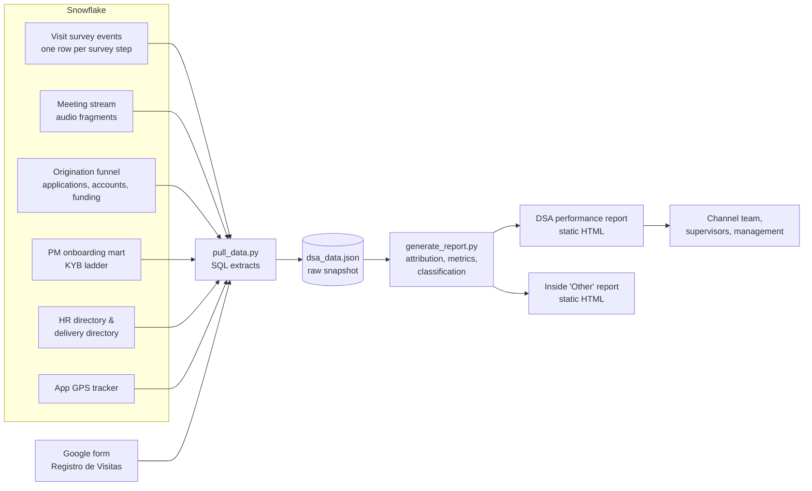
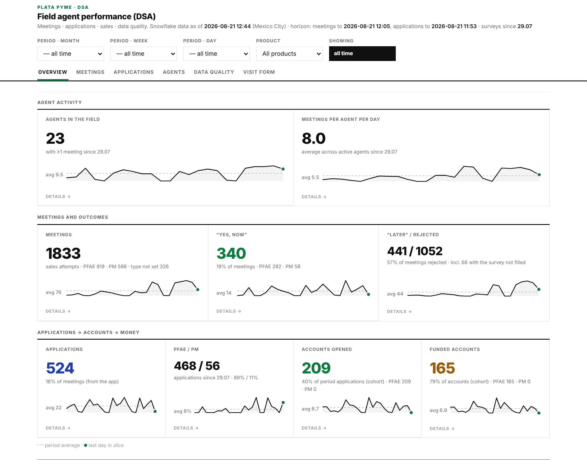
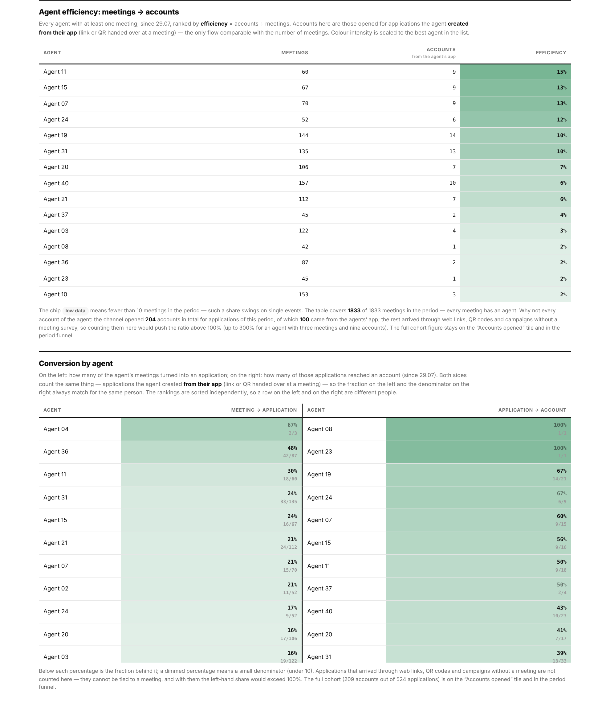
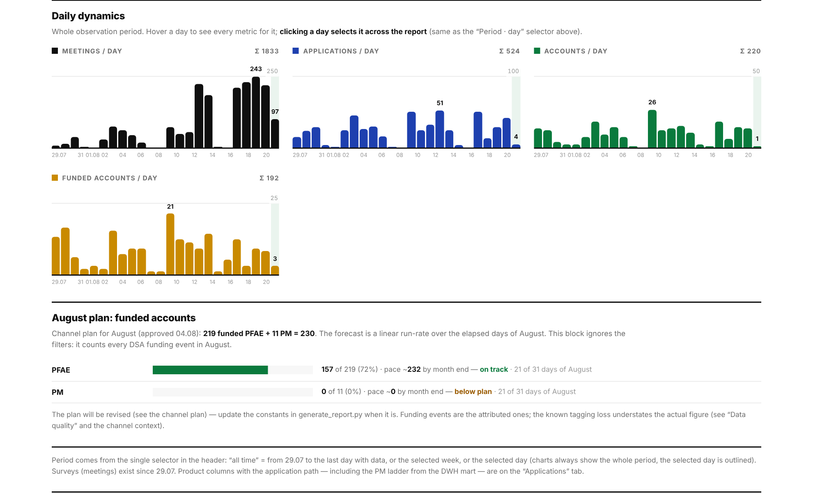
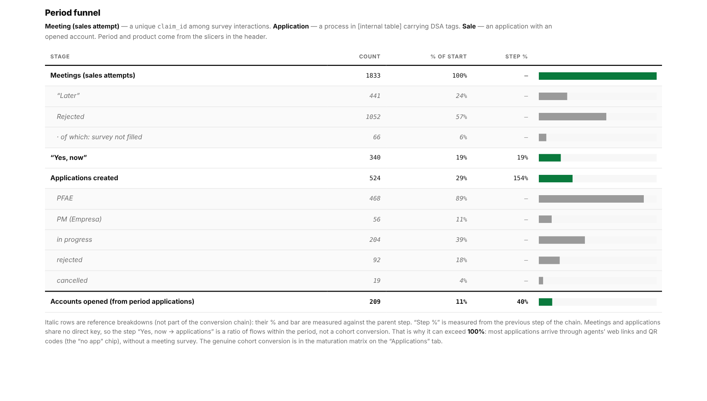
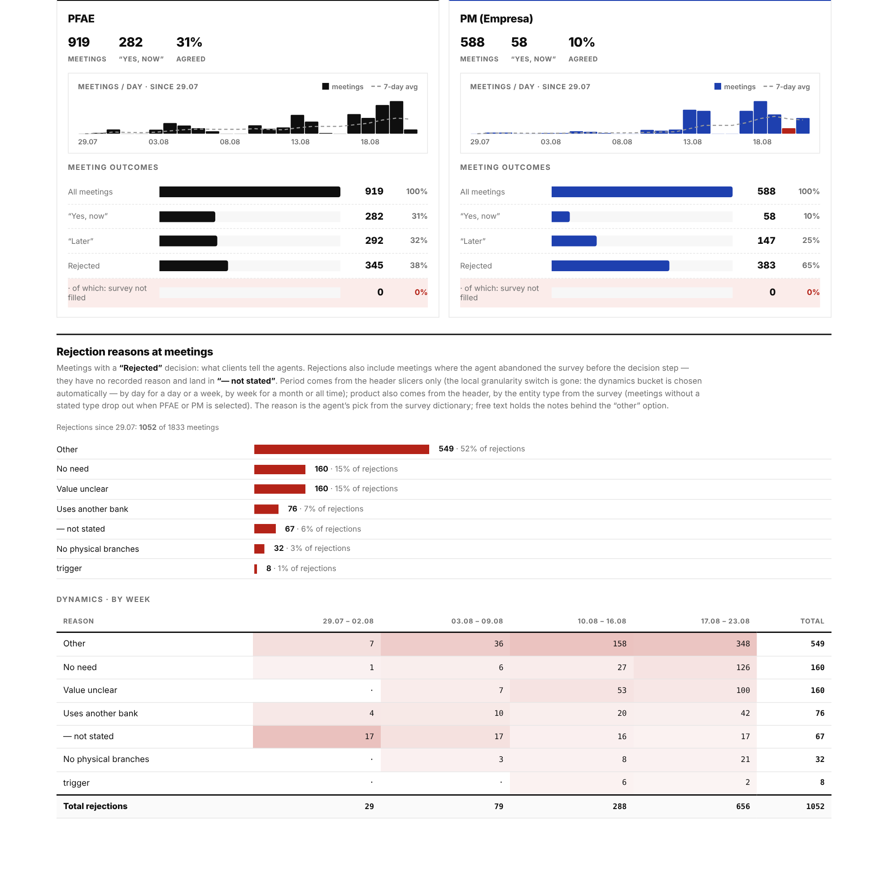
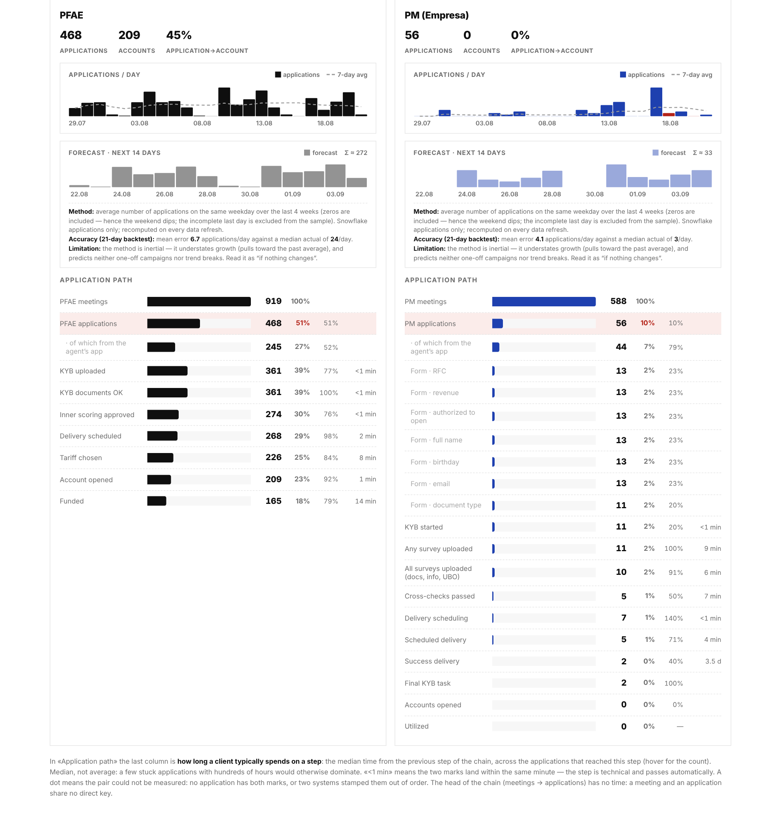
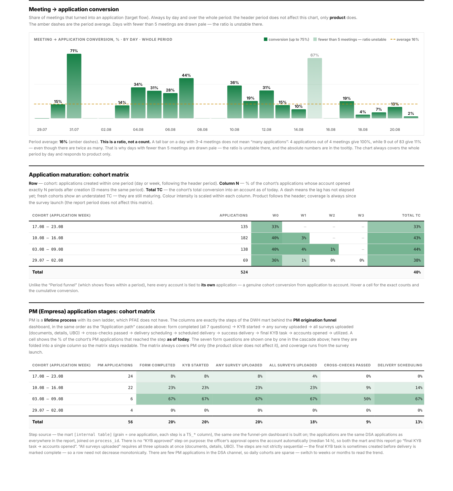
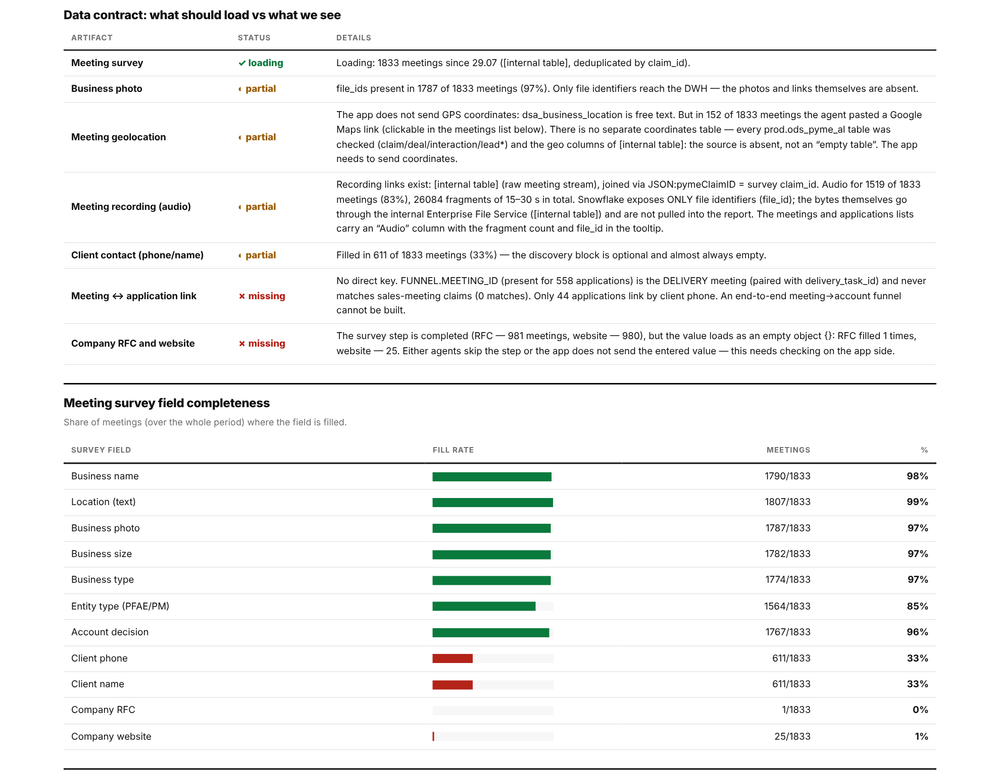
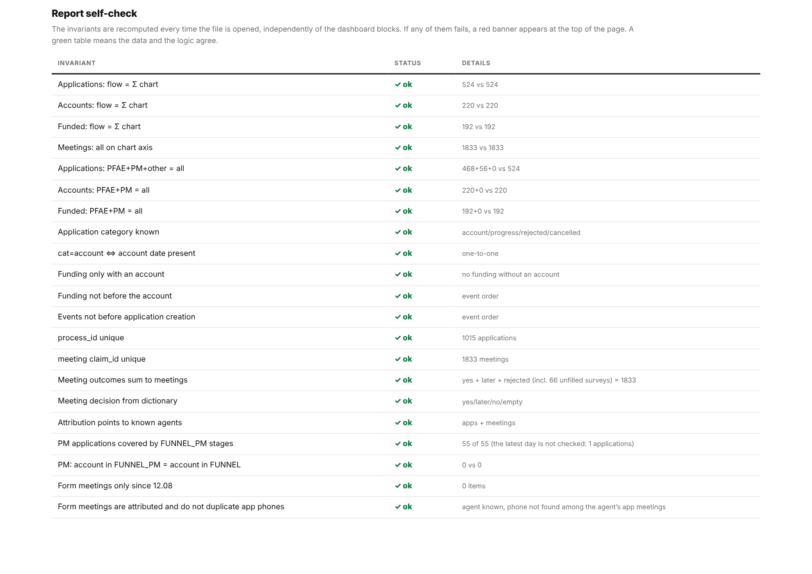

# 1. DSA acquisition channel: field-sales analytics from scratch

← [Back to portfolio](../README.md)

## Business context

The **DSA (direct sales agents)** channel is Banco Plata's field acquisition channel for small businesses.
Agents ("ambassadors") walk into shops, workshops and offices, pitch the **Plata Empresa** business account and either
send the owner a sign-up link on the spot or schedule a follow-up. Two products are sold:

- **PFAE** — sole proprietors (persona física con actividad empresarial), a short self-service onboarding;
- **PM** — legal entities (persona moral), a long process with a KYB ladder, document uploads and card delivery.

When the channel moved to a new in-app visit survey (launched on 29 July), management had no single view of the
channel: survey events, meeting recordings, applications, accounts, HR records and GPS tracks lived in different
systems, and the official dashboards undercounted the channel because of a tagging bug.

**Questions the business needed answered every day**
- How many meetings do agents run, and how many turn into applications, accounts and *funded* accounts?
- Which agents convert, and which only generate activity?
- Are we on track for the monthly plan?
- Can we trust the data — are agents where they say they are, and is every meeting really a meeting?

## My role

I owned analytics for the channel end to end: data model, attribution rules, the daily report, data-quality
monitoring and the channel's KPIs, and I worked with the channel manager, supervisors, Product and the DWH team on
fixes. Together with the coaching changes from the other case studies, meeting → application conversion grew by **3%**.

## What I built

A **single self-contained HTML report** (six tabs, ~30 blocks) rebuilt from Snowflake on demand and shared with the
channel team, plus the data pipeline behind it.

**Engineering choices**
- **Two-step pipeline:** `pull_data.py` takes raw extracts from Snowflake into one JSON snapshot; `generate_report.py`
  rebuilds every report from that snapshot offline in under a second. Logic can be changed and re-run without
  touching the warehouse, and every report is reproducible from its snapshot.
- **Static HTML with embedded data:** no server, no queries from the browser — the file opens anywhere and shows
  exactly the data slice stated in its header. A banner warns when the snapshot is older than a threshold.
- **Self-check on open:** two dozen invariants (e.g. *applications in the flow = sum of the chart*, *PFAE + PM + other = all*,
  *no funding without an account*, *every meeting attributed to a known agent*) are recomputed every time the file is
  opened; any failure shows a red banner at the top.
- Built with Python (pandas) and vanilla JS/SVG charts; developed with Claude Code, versioned in GitLab.

## Data model and attribution rules

| Entity | Definition |
|---|---|
| **Meeting** | one unique survey claim among visit-survey events; all step rows of a claim are merged in time order into one record |
| **Application** | an onboarding process in the origination funnel carrying a DSA tag |
| **Sale** | an application that reached an opened account; **funded** = first deposit made |

- **Meetings → agents** by the survey owner; **applications → agents** by the UTM tag of the sign-up link
  (HR ID for old web links, app ID for links sent from the app).
- **Agent names** resolve through a chain: manual mapping → HR directory → delivery directory (for new hires not yet
  in HR) → "unattributed". The fallback was added after new agents silently dropped out of every per-person view.
- **Entity type (PFAE / PM)** comes from the survey; when missing it is inferred from the linked application's
  product or from the tax ID length (13 characters = PFAE, 12 = PM).
- **Flow vs cohort.** Meetings and applications share no direct key (the link exists only through the client's phone).
  The report therefore separates *flows within a period* ("how much we sold this week") from *cohort conversion*
  ("what share of this week's applications became accounts") and labels which one every number is — mixing them
  gave ratios above 100% in early versions.
- Test accounts are excluded everywhere; time zone handling is explicit (Mexico City for business days, UTC for date arithmetic).

## The report

### Overview: activity → meetings → applications → money

Snapshot at 21 August (first 24 days after launch): 23 active agents, 8 meetings per agent per day, **1,833 meetings**,
340 "yes, now", **524 applications** (468 PFAE / 56 PM), **209 accounts** opened (40% of the period's applications)
and **165 funded**.

### Agent efficiency and conversion

Agents are ranked by **accounts per meeting** for applications created from their own app — the only flow that is
comparable one-to-one with meetings. Conversion is shown on two independent axes: meeting → application and
application → account, because an agent can be strong at one and weak at the other.

### Daily dynamics and the monthly plan

The August plan (219 funded PFAE + 11 PM) is tracked with a linear run-rate: PFAE was **on track** (157 of 219 with
pace to 232 by month end), PM was **below plan** (0 of 11) — which moved attention to the PM onboarding ladder.

### Period funnel

### Meeting outcomes and rejection reasons

**52% of all rejections were "Other"** with free text — the largest rejection reason was effectively unknown. This led
directly to [case study 4](04-other-rejections.md).

### Application path, 14-day forecast and PM ladder

For every step of onboarding the report shows how many applications reached it and the **median time from the
previous step** (median, not mean — a few stuck applications would dominate an average). A 14-day forecast of
applications per day (weekday average of the last 4 weeks, backtested MAE 6.7 per day vs a median of 24) helps plan
supervisor capacity. PM applications get their own 11-step KYB ladder.

### Meeting → application conversion and cohort maturation

Cohort matrices show what share of each week's applications became accounts after 0, 1, 2… weeks, so young cohorts
are not mistaken for poor ones.

## Data quality monitoring

A **data contract** lists every artifact the channel should produce and its loading status, and a completeness table
shows how often each survey field is filled. Issues found and escalated:

- **Tagging bug:** applications created from the agent app landed in "Unknown/Direct" in the official dashboards, so
  the channel was undercounted. Documented and escalated to the DWH team; the report counts them correctly.
- **No meeting ↔ application key:** only 44 applications could be linked to a meeting through the client's phone →
  requirement for an end-to-end meeting → account funnel key.
- **Survey fields not saved:** agents passed the tax ID and website step in ~980 meetings, but a value loaded in only
  1 and 25 of them (empty objects) → bug report to the app team.
- **Client contact captured in only 33% of meetings** → became a mandatory step in the survey redesign ([case 5](05-agent-app-visit-flow-and-field-guide.md)).
- **Audio coverage by agent** (83% of meetings have recordings) flags agents whose microphone failed or who never
  start the meeting in the app — the base for [AI QA](02-ai-qa-llm.md).

**Location checks** (on separate tabs, not shown — they contain addresses): the agent's GPS point at the start of each
meeting is compared with the postal code they typed, using a consensus centre per postal code built from other
agents' meetings; agent routes between meetings flag "moved but address unchanged", "static but different postal
code" and average speeds above 60 km/h between two visits.

## Impact

- One shared source of truth for the channel used daily by the channel manager and supervisors.
- Plan tracking and per-agent efficiency made coaching and staffing decisions concrete.
- Data issues (tagging, missing keys, unsaved fields) were found, quantified and handed to the owning teams.
- The rejection analysis, AI QA and weekly coaching report were built on top of this data model.

## Stack

Snowflake SQL · Python (pandas) · static HTML / JavaScript / SVG · Superset · Tableau · GitLab · Claude Code
