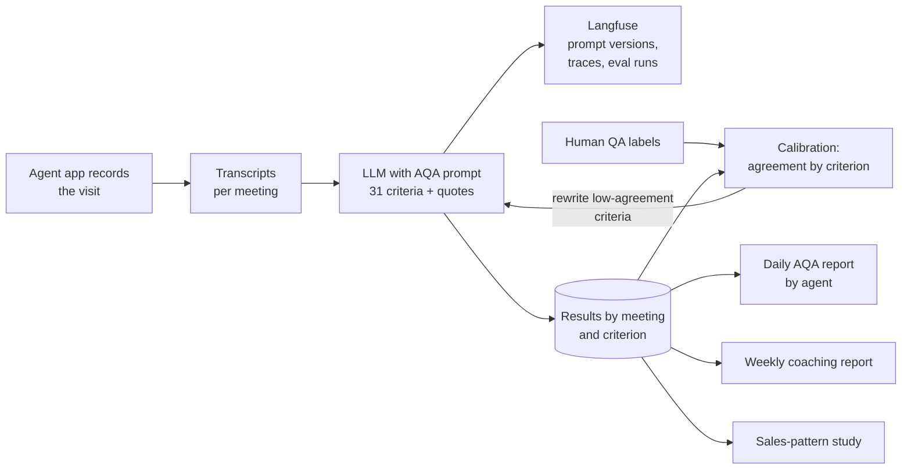
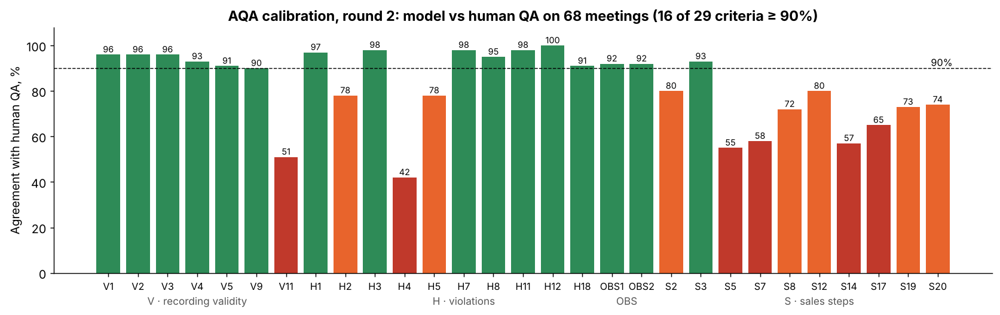

# 2. AI QA: LLM review of every recorded sales meeting

← [Back to portfolio](../README.md)

## Business context

Every DSA visit is recorded by the agent app while the visit survey is open (audio fragments of 15–30 s, transcribed
automatically). Human QA could listen to only a small sample, so three things stayed invisible:

- **Compliance risk:** false product claims (credit "coming soon", interest on the account, a terminal now),
  surveys marked "client agreed" when the client said "later", agents suggesting false data for the application.
- **Fake or simulated visits:** applications with nobody from the business on the recording.
- **Coaching signal:** whether the agent named any benefit, tried to close, or took the owner's contact.

## What I built

**AQA (automated quality assurance)** — an LLM reads the transcript of each meeting and fills a fixed checklist of
**31 criteria**, each answer backed by a **quote and a timecode** so a supervisor can open the audio at the right minute.

### The checklist

| Group | Purpose | Examples |
|---|---|---|
| **V — recording validity** (7) | Is the recording usable at all? A recording is invalid when 4+ checks fail | audio exists, transcript not empty, ≥ 60 s, enough speech, someone from the business is heard, recording is complete |
| **H — violations** (11) | Compliance; each with a severity: INFO / NOTE / WARN / CHECK / ESCALATE | no client on the recording (H1), survey says more than the client agreed (H2), recording paused mid-conversation (H3), false product information (H4), promising products that do not exist (H5), price and free period not explained (H6), pressure or rudeness (H7), suggesting false data (H8), asking for money (H11), selling third-party services (H12), personal phone use (H18) |
| **OBS — observations** | Context that is not a violation by itself | profanity not addressed to the client |
| **S — sales steps** | Coaching, no penalty | introduced by name, named Banco Plata, found the decision-maker, diagnosis first, PFAE/PM identified, honest limits, took contact, agreed next step, handled rejection |

### Design choices

- **Verifiable yes / no / n.a. answers with evidence**, not a 1–10 "quality score": every flag can be checked in 30
  seconds by listening from the quoted minute.
- **Known allowed statements are whitelisted** (for example, paying taxes from the account is allowed) to avoid false alarms.
- **Severity decides routing:** ESCALATE goes to the channel manager the same day, CHECK to QA, NOTE/INFO to coaching.
- **Prompt versions are tracked in Langfuse**, and every prompt change is re-run on the same labelled set before it is
  used — no "it looks better" changes.
- Recording only runs while the survey is open, so V11 (recording complete) is measured but **not** held against the agent.

## Calibration against human QA

Human QA labelled the same meetings independently; I compared the model criterion by criterion and iterated on the
wording of each check.

Round 2: **16 of 29 compared criteria at 90–100% agreement**, including recording validity and the key compliance
checks (no client on the recording 97%, recording paused 98%, rudeness 98%, false data 95%, asking for money 98%).
Low-agreement criteria were handled explicitly:

- **H4 false product information (42%)** — the model over-flagged mentions of future products; the criterion was
  narrowed and the bank's own product facts were added to the prompt.
- **V11 recording complete (51%)** — depends on survey timing, not on the agent; kept as information only.
- **S-steps at 55–80%** — sales steps are inherently more subjective; used for coaching trends, never for sanctions.

The version used for the October analysis (v5.3) was calibrated on 178 QA-labelled meetings; v5.4, with facts from
the bank's website, keeps the same agreement and removes two noisy flags. Full table:
[`../artifacts/aqa_calibration.md`](../artifacts/aqa_calibration.md).

## Outputs

- **Experiment matrix:** for a batch of meetings, one row per meeting and one column per criterion (✓ / ✗ violation /
  ✗ step missed / n.a.); hovering shows the quote and timecode — used to review prompt versions with QA.
- **Daily AQA report by agent:** every recording with a violation, the problem, the quote in Spanish and
  "listen from mm:ss", plus the list of clients worth a second visit (one day: 28 recordings with a violation and
  113 clients to revisit).
- **Inputs for the weekly coaching report** ([case 6](06-weekly-report-and-slack-alerts.md)) and the
  **sales-pattern study** ([case 3](03-sales-patterns.md)).

## Automation path

Daily transcripts → LLM evaluation with traces in Langfuse → results in the warehouse → Slack post in the format
supervisors already use. The model and the post format are ready; productionising each link was handed over to its owning team.

## Stack

Python · LLM API · Langfuse · Snowflake · prompt engineering and evaluation · Claude Code · GitLab
