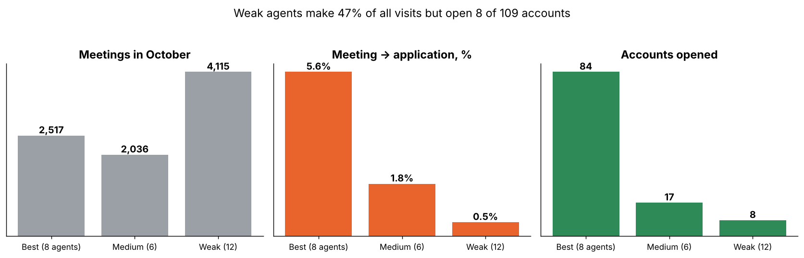
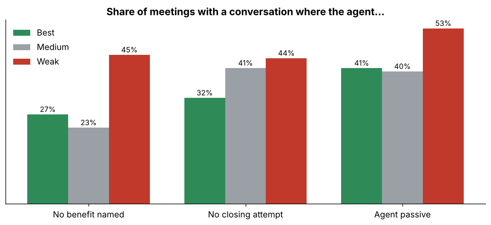
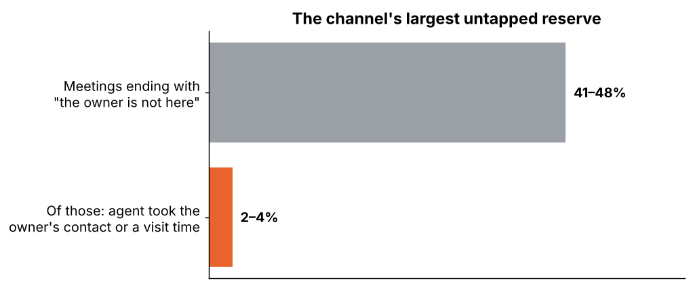
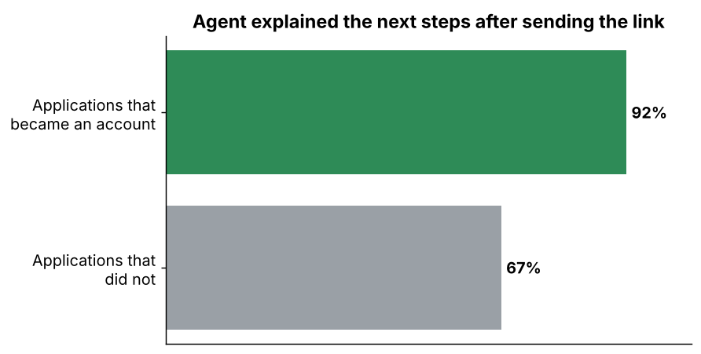

# 3. How the best and the weakest agents sell

← [Back to portfolio](../README.md)

## Business question

With the same product, the same territory and the same training, some agents converted ten times better than others.
Management's default explanation was effort ("the weak ones make fewer visits"). I tested what actually happens
inside the meetings.

## Data and method

| Step | Detail |
|---|---|
| Population | one month of DSA visits: 8,755 visits in surveys, 6,021 with a transcript, **5,866 reviewed by the model (97%)** |
| Comparison set | **26 agents** with 60+ visits; **4,873 meetings** where someone from the business is heard (recordings with the agent alone or only data entry excluded) |
| Tagging | the AQA prompt ([case 2](02-ai-qa-llm.md)) plus a "sales approach" block: visit stages, benefits named, objections and answers, closing type, agent style, turning point — every field backed by a quote with a timecode |
| Grouping | built **after** the model run, from the funnel: **best** = conversion ≥ 3.5% and ≥ 4 accounts, **weak** = conversion ≤ 1.2% and ≤ 2 accounts, **medium** = the rest. The model never knew who the agent was or their results, so the tagging cannot be fitted to the outcome |

## Findings

### 1. The weak make half of the visits and almost no accounts

Effort is not the problem: weak agents make **47% of all visits** but open **8 of 109 accounts**. Conversion meeting →
application: best 5.6%, medium 1.8%, weak 0.5%.

### 2. The weak don't sell badly — they don't sell

All groups follow the same visit structure (greeting, looking for the decision-maker, questions about the business).
The weak fall behind only where the agent has to do the talking: in 45% of their meetings no benefit is named at all,
in 44% there is no closing attempt, and in 53% the agent is passive and waits for the client.

### 3. The medium talk the most — about the wrong things
The medium group names benefits more often than anyone, but benefits a shop owner cannot relate to in two minutes at
the counter: electronic invoices, tax savings, "the app". They lose most often to an objection (27%) and most often
get a "no" (32%).

### 4. The best sell simply and go straight to sign-up
Three arguments: **free account with no fees**, **card in hand today plus cashback**, **opened in five minutes**. They
ask for the client's contact and send the link on the spot ("I'll send a link to your number") in 10% of meetings
vs 2% for the weak, and close with the next step rather than with "shall we open it?".

### 5. "I already have a bank" — only the best answer it
It is the main objection. The best answer with a concrete benefit ("you don't need to close your account — use ours as
petty cash"); the others agree and leave. The best also trigger fewer objections (39 per 100 meetings vs 46–54).

### 6. "The owner isn't here" is the biggest loss, and nobody works on it

41–48% of meetings in every group end with the owner not on site, and in 96–98% of them the agent leaves without the
owner's WhatsApp or a visit time. This is the channel's largest untapped reserve — and the reason the app flow was
redesigned ([case 5](05-agent-app-visit-flow-and-field-guide.md)).

### 7. An application becomes an account when the agent explains what happens next

Of 164 meetings with an application, the agent explained the steps after the link (link → complete the application →
SMS code → documents → card) in **92% of those that became accounts vs 67% of those that did not** — the strongest
single sign of a future account, and the cheapest to fix: one sentence after sending the link.

### 8. Conversion and compliance are separate
The best agents are not more compliant: risky claims (mostly promising interest on the account) appear three times
more often among the best and medium than among the weak. Sales coaching and compliance control need separate metrics.

## Recommendations (presented to channel management)

1. **Script:** a basic three-argument pitch; two mandatory answers ("I already have a bank" → petty cash; "owner isn't
   here" → owner's WhatsApp and a visit day as a survey step); one sentence after the link explaining the next steps,
   plus a reason to decide today.
2. **Control:** a minimum meeting standard checked by AQA every day — at least one argument, a closing attempt, a
   contact when the decision-maker is absent — and a daily list of applications with no client on the recording for QA
   (24 of 164 in the month).
3. **Pilot to prove causality:** split new agents in half for two weeks in the same zones — new script vs current —
   and compare meeting → application conversion, application → account, share of meetings with the owner's contact,
   and AQA compliance.

## Limitations stated in the study

- The "sales approach" block is the model's assessment; every number is backed by a quote but was not double-checked by people.
- Recording runs only while the survey is open: 68% of meetings with an application miss the start of the conversation.
- Groups are built on one month and not normalised by zone; a few agents dominate the medium and weak groups.

## Stack

Snowflake · Python · LLM tagging with evidence · Langfuse · English deck for management (16 slides)
