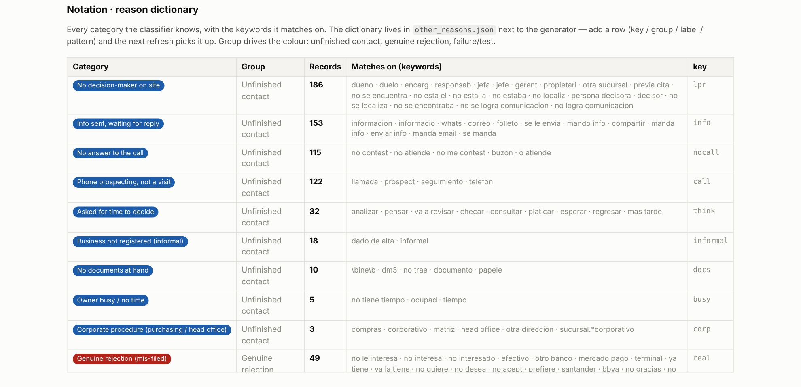
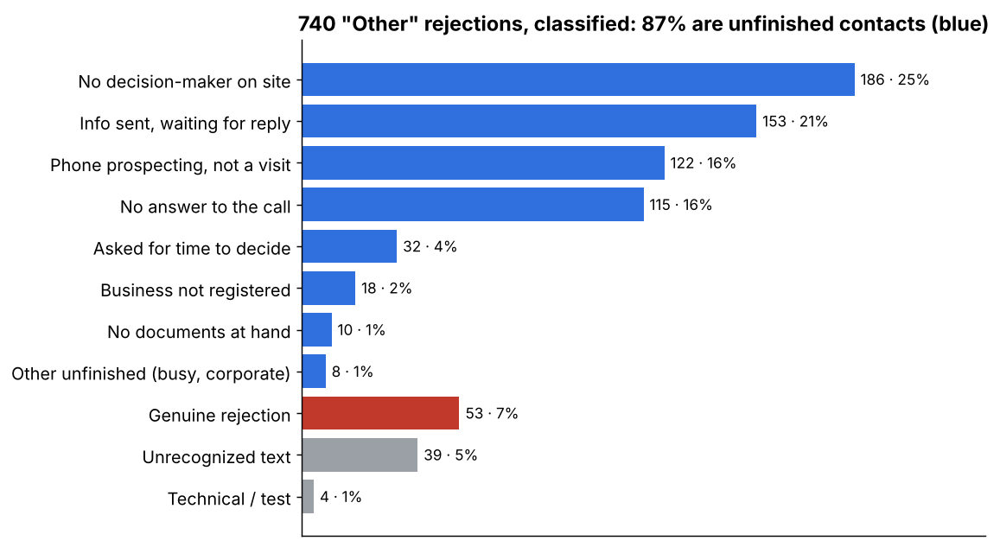
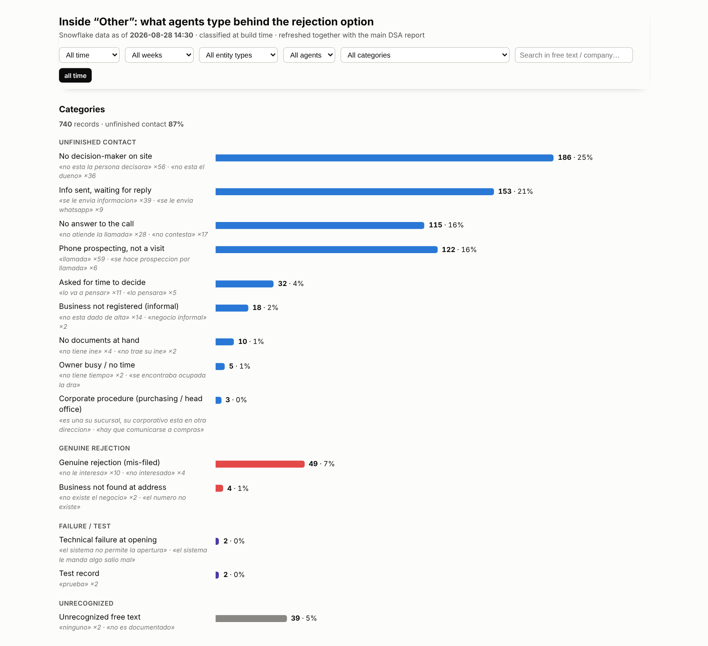
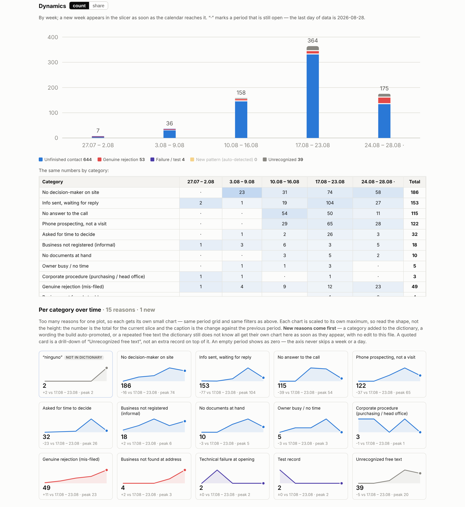

# 4. Inside "Other": what agents type behind the rejection option

← [Back to portfolio](../README.md)

## Business problem

In the visit survey, an agent who records a rejection picks a reason from a list. In the channel report
([case 1](01-dsa-channel-reporting.md)) **"Other" was 52% of all rejections** — the single largest rejection reason
was a free-text field nobody read. The rejection rate looked alarming, and product decisions were being discussed on top of it.

## What I built

A companion report generated in the same run as the main channel report (so both always show the same data slice),
which classifies every "Other" text and shows what is really behind it.

**Which records count:** reason = "Other" **and** decision = "no" or empty. An abandoned survey (no decision) is
counted as a rejection — a documented decision in the report specification.

**Text classification**
1. **Normalisation:** Unicode NFKD → strip accents (ñ → n) → collapse spaces → lower case
   (`«  NO está  el DUEÑO »` → `no esta el dueno`).
2. **Dictionary of regular expressions** in a JSON file next to the generator — each row is
   `key / group / label / pattern`; rules run in order and the first match wins. Adding a category is one JSON row, no code change.
3. **Groups give meaning and colour:** *unfinished contact* (not a rejection), *genuine rejection* (mis-filed),
   *failure / test*, *new pattern*, *unrecognised*.
4. **Self-extending:** any identical normalised text that the dictionary misses and that repeats 5+ times is promoted
   automatically to a "New pattern" category for that build; rarer texts are listed as candidates with a ready-to-paste JSON row.

## Finding

Of **740** "Other" records, **644 (87%) were not rejections at all but unfinished contacts**: the owner was not on site
(25%), information was sent and the agent was waiting for a reply (21%), the "visit" was actually a phone call (16%),
nobody answered the call (16%), the client asked for time to decide (4%), the business was not registered yet, there
were no documents at hand. Only **53 (7%) were genuine rejections** that should have used an existing reason.

The survey simply had no answer for the most common real situation — *I did not talk to the person who decides* — so
agents used "Other".

## The report

- **Categories:** counts and shares per category with the most frequent example phrases.
- **Dynamics:** by week, counts or shares, stacked by group, with the same numbers in a table; small multiples per
  category, each scaled to its own maximum, new categories first.
- **All records** with filters (agent, entity type, category, free-text search) — not shown here, it contains client names.
- **Dictionary** and **new candidates** sections, so the business owner can extend the classifier without an analyst.

## Impact

- The headline rejection rate was corrected: most "rejections" were future opportunities, not lost clients.
- **Product change:** the findings fed into the visit survey redesign, where "I did not talk to the decision-maker" leads to a
  "Later" flow that captures the owner's contact and an appointment, instead of a rejection
  ([case 5](05-agent-app-visit-flow-and-field-guide.md)). The field guide now states it as the central rule:
  *if it was not the person who decides, the visit is a "Later", never a rejection.*
- It also showed that part of "visits" were phone prospecting, which matters for visit-based productivity metrics.

## Engineering notes (from the specification I wrote)

- Classification runs **at build time**, not in the browser, so the classification always matches the data slice in the header.
- All date arithmetic is in UTC: local midnight + `toISOString()` shifts dates by a day in any time zone east of
  Greenwich — invisible in Mexico City, visible from Europe.
- Filter options must partition the whole: an early version had a "type not set" filter that missed 64 records with
  the raw value "other"; after the fix PFAE + PM + not identified = 202 + 288 + 250 = 740.
- A category with 1 record of 740 is drawn as a 0.5-px sliver rather than stretched for visibility: the exact number is
  in the legend, tooltip and table.

## Stack

Snowflake · Python (regex classifier, JSON dictionary) · static HTML/JS report · written specification for maintainers
