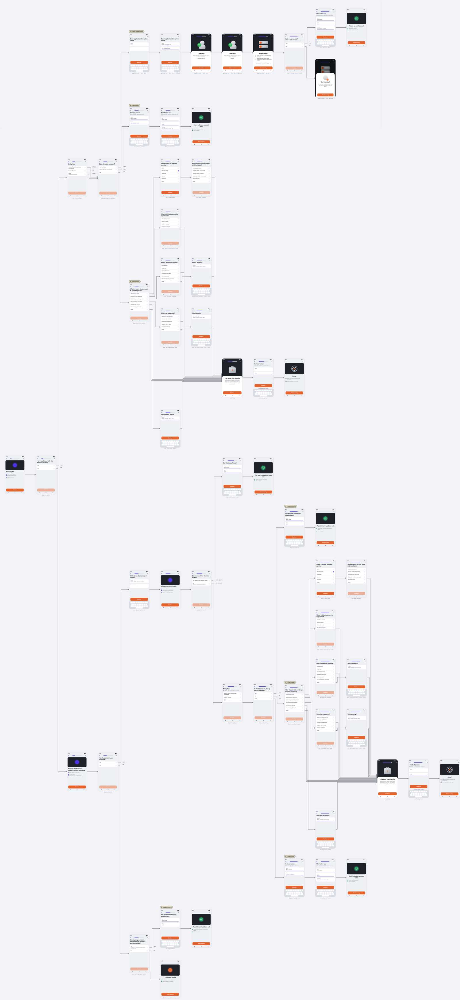
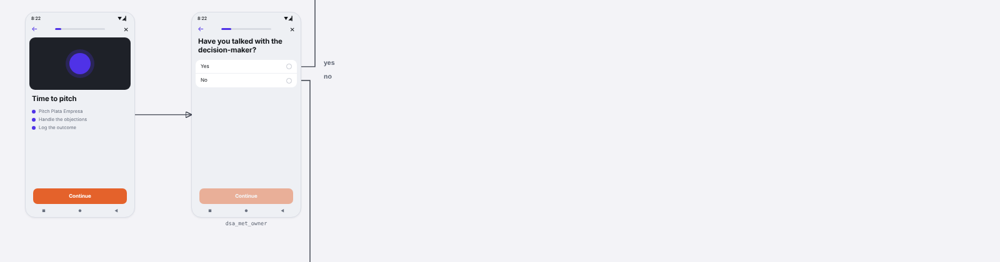
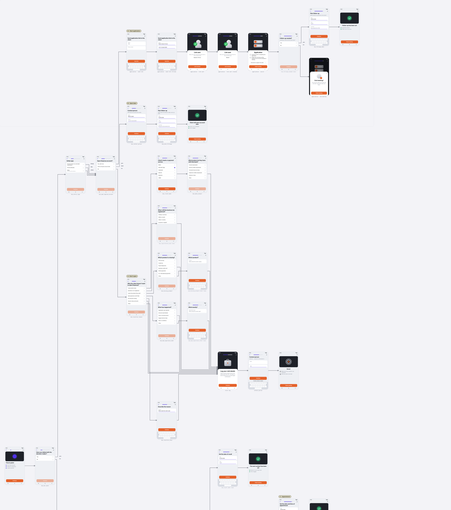
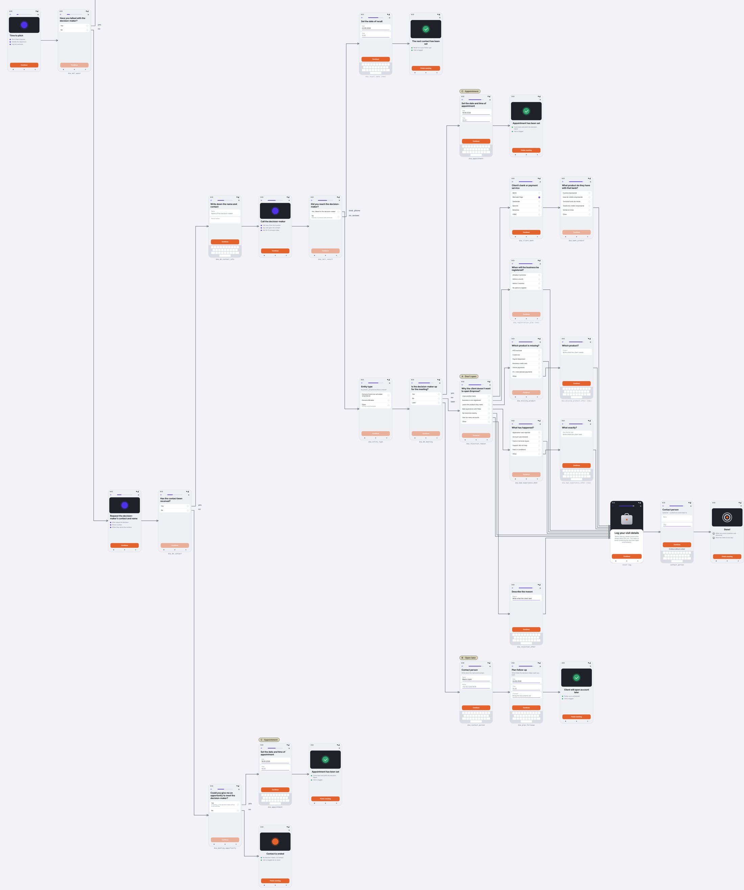
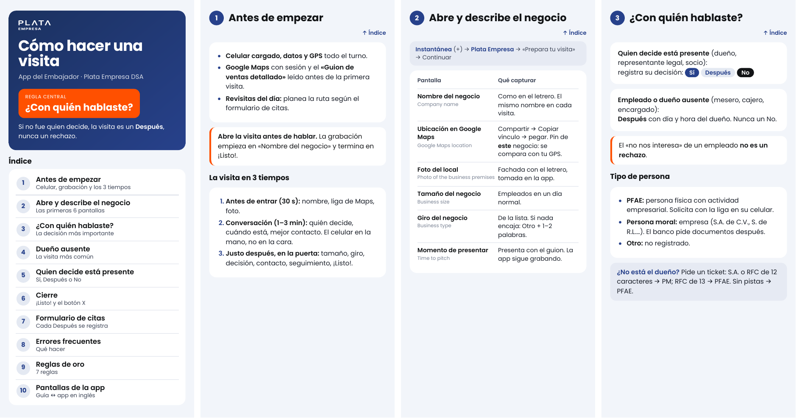

# 5. Agent app: visit survey flow and field guide

← [Back to portfolio](../README.md)

## Problem

The data told the same story from three directions:

- 52% of rejections were "Other", and 87% of those were **unfinished contacts** ([case 4](04-other-rejections.md));
- 41–48% of meetings ended with **"the owner isn't here"**, and almost none of them captured the owner's contact ([case 3](03-sales-patterns.md));
- the client's phone was filled in only **33%** of meetings, so a meeting could not be linked to the application it produced ([case 1](01-dsa-channel-reporting.md)).

The root cause was the visit survey in the agent app: it had no path for the most common real situation — *I talked
to an employee, not to the person who decides* — so agents recorded a rejection or "Other" and the opportunity was lost.

## What I did

### 1. Mapped the full visit flow, screen by screen

I rebuilt the Figma board of the visit survey as an interactive screen-flow map — every screen, every answer and every
transition, laid out as a tree so that branches never cross, with each screen's question tag from the data model under
it. It became the shared reference for Product, Design, Engineering and the channel team when discussing changes.
Interactive version: [`../artifacts/visit_screen_flow.html`](../artifacts/visit_screen_flow.html) (open in a browser).

**The key question that splits the visit:**

**Branch 1 — the decision-maker is present:** entity type (PFAE / PM / other) → "Open Empresa account?" →
**Yes, now:** send the application link → link sent → application → follow-up needed? → plan follow-up or end meeting;
**Later:** contact person → plan follow-up → "client will open later"; **No:** why not (another bank → which bank and
product; missing product → which one; bad experience → what happened; other → free text) → log visit details → Done.

**Branch 2 — the decision-maker is absent:** request the decision-maker's name and contact → "has the contact been
received?" → plan an appointment with the owner (day and time) → log visit details → Done. An absent owner can no
longer be recorded as a rejection.

### 2. What the redesigned flow changes

Requirements were agreed with Product, Design and Engineering in Jira and Confluence. The new flow:

- "Have you talked with the decision-maker?" as an early, mandatory question that routes the visit;
- an absent decision-maker leads to a **"Later" with the owner's contact and an appointment**, never to a rejection;
- "Other" in the entity type continues to the account question instead of a dead end;
- the client's phone and an appointment time become required in the "Later" paths, so revisits can be planned and
  meetings linked to applications;
- recording starts with the business name and ends at "Done!", so AQA ([case 2](02-ai-qa-llm.md)) hears the whole conversation.

### 3. Field guide for agents (Spanish, mobile format)

The new flow only works if dozens of agents use it the same way, so I wrote a mobile guide they can read on their phone
between visits. Ten short sections: before you start, opening and describing the business, *who did you talk to?*,
owner absent, decision-maker present, closing, the appointment form, frequent errors, golden rules, and an
English ↔ Spanish map of app screens (some phones run the app in English).

**Central rule:** *if it was not the person who decides, the visit is a "Later", never a rejection.*

Practical details that came from the data:
- **The visit in three moments:** before entering (30 s: name, Maps link, photo), the conversation (1–3 min: who
  decides, when they are here, best contact — phone in hand, not in the face), right after at the door (size, type,
  decision, contact, follow-up, Done!).
- **Owner absent — a way back to the owner:** who decides (name and role), when they are here (day and time — ask
  twice), how to contact them (owner's mobile, business WhatsApp, email, Instagram).
- **Data quality rules:** type the 10 digits by hand (pasting "+52" cut two digits off numbers), use the same business
  name and the same Maps link on every revisit, never invent a phone number or enter your own.
- **Entity type without asking:** a receipt with "S.A." or a 12-character tax ID means a legal entity (PM), 13 characters a sole proprietor (PFAE).
- **The X button** (end meeting) only for a technical failure, a person who left, or an existing client — not for an absent owner.
- **Every "Later" goes into the appointment form** right after Done!, so supervisors can count and plan revisits.

## Expected impact

- Unfinished contacts become trackable **follow-ups with a contact and a date** instead of lost "rejections".
- The rejection rate in reporting means rejections again, so product decisions are not made on inflated numbers.
- Capturing the client's phone improves the meeting → application link and therefore every conversion metric in the channel.

## Stack

Figma · Miro · interactive HTML screen-flow map · Jira · Confluence · Google Forms · field guide (PDF, mobile layout)
