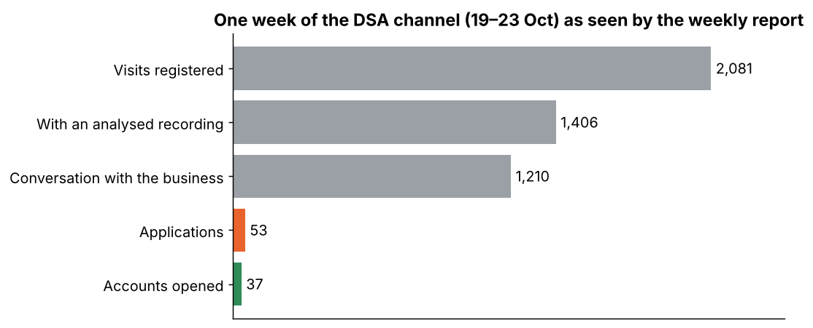

# 6. Weekly coaching report and daily Slack alerts

← [Back to portfolio](../README.md)

## Goal

Turn the analysis into a routine. Supervisors do not open dashboards in the field — they read Slack on their phone
between visits. So the findings from AI QA ([case 2](02-ai-qa-llm.md)) and the sales-pattern study
([case 3](03-sales-patterns.md)) had to arrive as short, actionable messages: *who, what, which recording, what to do*.

## Weekly coaching report (every Friday morning)

Built from the week's recordings and the funnel; all figures are per agent per week, over visits where someone from
the business can be heard.

**1. Channel summary** — visits registered, visits with an analysed recording, conversations with the business,
applications / accounts (week of 19–23 October: 2,081 → 1,406 → 1,210 → 53 / 37).

**Agent groups set from that week's funnel** (agents with 20+ visits): best (conversion ≥ 3.5% and at least one
account), weak (≤ 1.2% and no accounts), medium (the rest), not rated (fewer than 20 visits).

**2. Nine coaching criteria**, each with a per-agent threshold and a prescribed action:

| # | Criterion | All | Best | Medium | Weak | Flag when | Action |
|---|---|---:|---:|---:|---:|---|---|
| 1 | Explained the steps after the link (of applications) | 75% | 76% | 80% | — | below 70% with 4+ applications | coach, listen first |
| 2 | Application with nobody from the business on the recording | 2 of 47 | 2 | 0 | 0 | every case | QA listens |
| 3 | Client agreed to open in their own words (of applications) | 29% | 27% | 50% | — | every case | QA listens |
| 4 | Mentioned the card, opening in minutes or cashback | 35% | 42% | 50% | 21% | below 40% | coach, listen first |
| 5 | Mentioned no benefit at all | 38% | 26% | 32% | 48% | above 35% | field ride-along |
| 6 | Gave a reason to decide today | 21% | 30% | 25% | 12% | below 25% | coach, act directly |
| 7 | Passive agent | 18% | 9% | 16% | 24% | above 50% | field ride-along |
| 8 | "I already have a bank" answered with a benefit | 46% | 60% | 39% | 48% | below 60% with 3+ cases | coach, listen first |
| 9 | Owner absent: got their WhatsApp or an appointment | 17% | 9% | 15% | 21% | below 1 in 10 with 5+ cases | field ride-along |

Each action comes with the line to teach, taken from what the best agents actually say — e.g. for criterion 6
*"Sin costo, dos meses gratis, lo abrimos ahorita en cinco minutos"*, for criterion 8 *"you don't need to close your
account — use ours as petty cash"*.

**3. Assessment by agent** — a matrix of agents × 9 criteria, red where the agent crosses the threshold, so a
supervisor sees in one glance whom to coach on what.

**4. Agent details** — for each flagged agent, the recordings to listen to: criterion, date, the quote in Spanish and
a "listen" link to the exact minute. Coaching starts from evidence, not impressions.

A reminder that group averages need the case counts next to them: criterion 9 is *higher* for the weak group (21% of
257 cases) than for the best (9% of 96), so it is flagged per agent only with 5+ cases.

## Daily Slack alerts

Posted to the channel's Slack by a bot, with the supervisor tagged and a request to call the listed agents, find the
cause and reply in the thread (screenshots are not shown here because they contain agents' names):

| Alert | When | What it shows |
|---|---|---|
| **DSA · alerts** | 18:00 | per agent: visits without an application, applications whose GPS is far from the business link, meetings without GPS, pauses / suspicious rhythm of meetings → verdict *call urgently / all OK / no meetings today* |
| **DSA daily — PFAE / PM** | next morning | yesterday's meetings, "later", applications and opened accounts per agent and product; agents with no client agreements; agents not using the app in the last 14 days; a reconciliation note against the official dashboard |
| **DSA · data until 16:00 / 18:00** | twice a day | team ranking by meetings, applications and accounts with the change since the previous post; top, middle and bottom thirds coloured so agents see where they stand during the day |

## Engineering

- Python jobs on top of the same Snowflake extracts as the channel report ([case 1](01-dsa-channel-reporting.md)), so
  the numbers in Slack, the report and the weekly PDF always agree.
- Report rendering to HTML/PDF, images for Slack cards, posting via a Slack bot.
- Code in **GitLab**, developed with **Claude Code**.

## Impact

- Supervisors get a short list of *whom to call today* instead of a dashboard to interpret.
- Coaching is tied to concrete recordings and to the behaviours that the data showed drive accounts.
- Fake or suspicious visits are flagged the same day instead of at month-end.

## Stack

Python · Snowflake · Slack bot · HTML/PDF reports · GitLab · Claude Code
