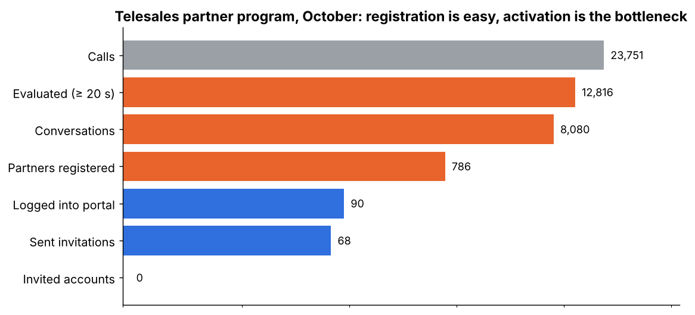
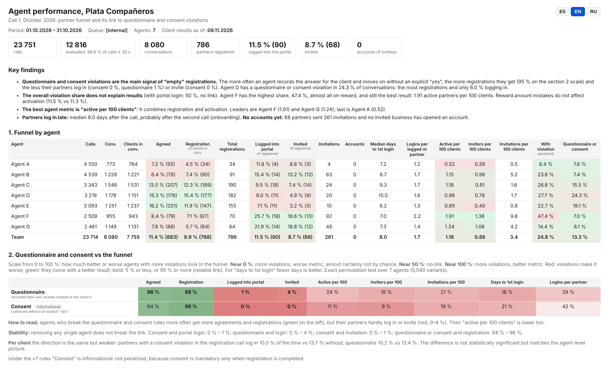
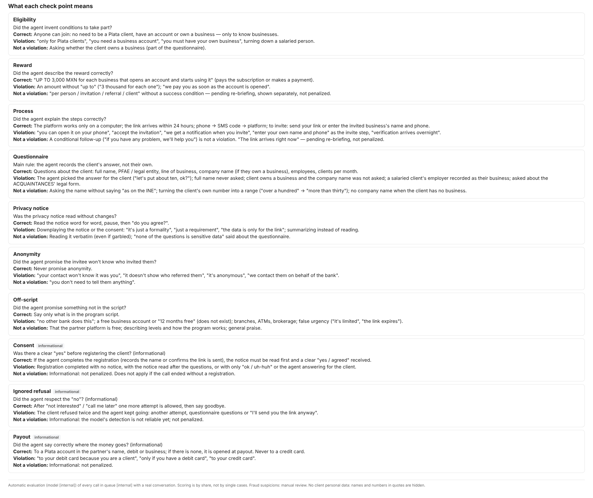

# 7. Telesales partner program: why registrations did not turn into activity

← [Back to portfolio](../README.md)

## Business context

**Plata Compañeros** is a referral program: anyone who knows small businesses can join as a partner, invite businesses
through a web portal and earn up to 3,000 MXN for each invited business that opens an account and starts using it.
A telesales team called businesses to sign them up as partners. Registrations looked healthy, but nobody knew whether
they produced any activity.

## Scope

One month (1–31 October), one telesales queue, **7 agents**, client outcomes as of 9 November:
**23,751 calls**, 12,816 evaluated (99.6% of calls of 20 s or longer), **8,080 conversations**.
Report in three languages (Spanish for the team, English and Russian for management), switchable in one file.

## Funnel

786 partners registered → **11.5%** logged into the portal → **8.7%** sent at least one invitation (261 invitations in
total) → **0 accounts** opened by invited businesses so far. Partners log in late: a median of 8 days after the call,
most likely after the second (onboarding) call.

**Attribution:** partners are created in a nightly batch, so each partner is credited to the agent of the last call
within the previous 3 days. Logins come from the portal, invitations and invited accounts from the program's tables.

## Call quality evaluation

Every call with a real conversation was evaluated by an LLM against a versioned checklist (rules v7):
**7 penalised check points** — eligibility (inventing requirements to join), reward (amount without "up to", paying
"as soon as the account opens"), process (the portal works on a computer only, the link arrives within 24 h, phone →
SMS code → portal), **questionnaire** (the agent records the client's answers, not their own), privacy notice,
anonymity (never promise the invitee won't know who referred them), off-script promises — plus informational points
(**consent**, ignored refusal, payout). Each point has a definition of correct, violation and *not* a violation, so the
rules are auditable.

## Findings

1. **Questionnaire and consent errors are the main signal of "empty" registrations.** Agents who more often fill in
   the questionnaire themselves and continue without an explicit "yes" get *more* agreements and registrations, but
   their partners almost never log in or invite.
2. **The overall error rate explains nothing** (relation to portal login: 50%, i.e. no link). The agent with the highest
   error share (47%, almost all about the reward wording) has the best result. Reward-amount mistakes do not affect
   activation (11.5% vs 11.3%). *What* goes wrong matters, not *how much*.
3. **One metric for the agent: active partners per 100 clients in conversation** — it joins registration and activation,
   so an agent cannot look good by registering partners who never come back. Leader 1.91, lowest 0.52.
4. **No invited accounts yet:** 68 partners sent 261 invitations and none of the invited businesses has opened an account —
   the program's bottleneck is after registration, not in the calls.

## Statistics behind the claims

With 7 agents, correlation coefficients are meaningless, so I used an **exact permutation test**: all 5,040 orderings
of the 7 agents, reported as a 0–100% scale (near 0% — more errors, worse metric, almost certainly not chance; near 50% —
no relation; near 100% — more errors, better metric).

- Consent errors vs portal login: **0%**; questionnaire errors vs login: **1%**; consent vs inviting: **0%**.
- Errors vs registrations: 94–99% (more errors → more registrations).
- **Stability:** removing any single agent keeps the result (consent and login 0–1%, questionnaire and login 0–4%).
- **Per client** the direction is the same but weaker: partners with a consent error in their registration call log in
  in 10.0% of cases vs 13.7% without; not statistically significant on its own, but consistent with the agent level.

## Recommendations

- Re-brief agents on the questionnaire and consent: record the client's own answers and get an explicit "yes" before registering.
- Measure agents on **active partners per 100 clients**, not on registrations.
- Fix the activation path (portal login and first invitation) before scaling call volume.

## Stack

Snowflake · Python · LLM call evaluation · exact permutation tests · trilingual HTML report (ES / EN / RU)
